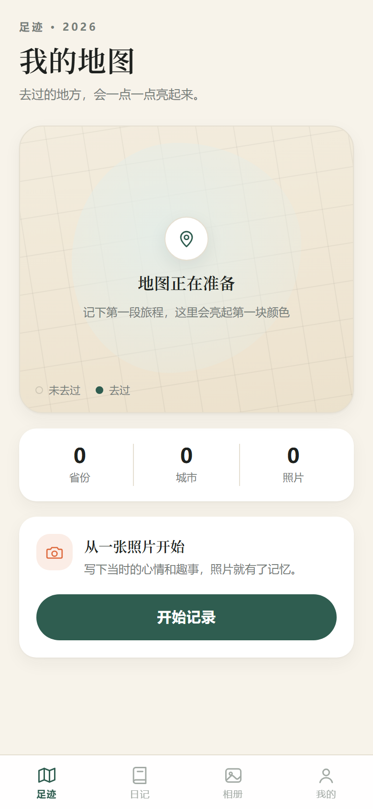
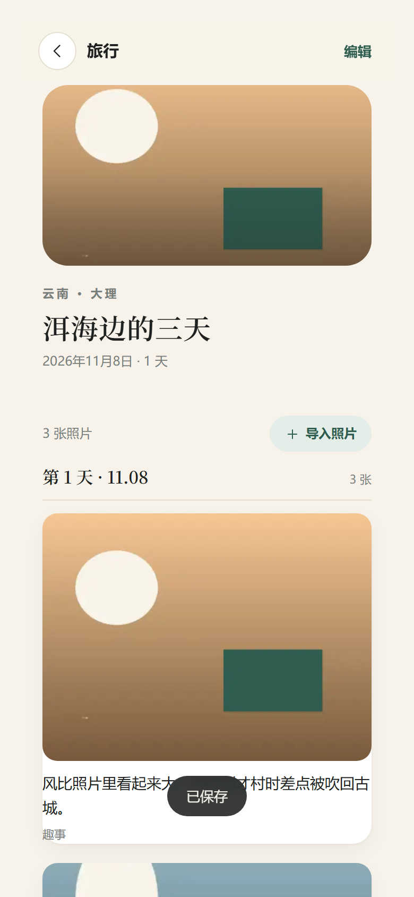
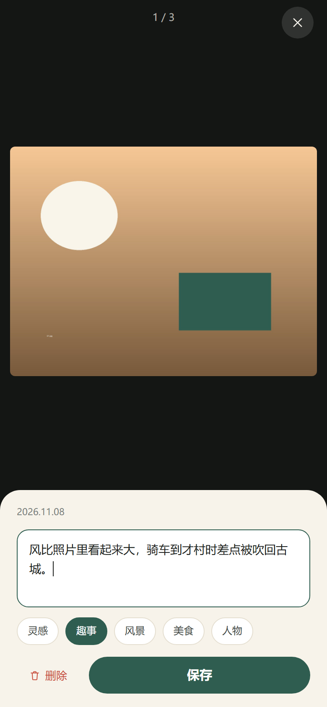
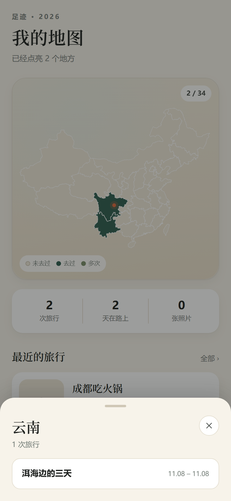

# 行迹 · Travel Diary

> 给照片写故事，让足迹在地图上亮起来。
> Photographs, notes, and a map that lights up where you've been.

[](https://github.com/Azunyan666/travel-diary/actions/workflows/ci.yml)
[](https://github.com/Azunyan666/travel-diary/actions/workflows/deploy-pages.yml)
[](./LICENSE)

**中文** | [English](./README.en.md)

**在线体验**：<https://azunyan666.github.io/travel-diary/>

> 当前版本 **v0.4.4**：Web 端功能完整（记录、标注、地图、备份），Android APK 支持应用内更新检查与系统返回键分层返回（见 [路线图](./docs/ROADMAP.md)）。



| 旅行时间线 | 照片标注 | 点省份 |
|---|---|---|
|  |  |  |


---

## 这是什么

行迹是一款**移动端优先、数据只存在本机**的旅行日记：

- 旅行时导入照片，照片按拍摄时间自动排进那一天的日记
- 每张照片下面写一段话：当时的灵感、同行的趣事、为什么按下快门
- 去过的省份 / 国家会在地图上亮起来，一眼看到自己走过哪里

没有账号、没有服务器、没有埋点。照片和文字都存在浏览器的 IndexedDB 里，可以随时打包导出。

## 功能状态

| 功能 | 状态 |
|---|---|
| 移动端应用外壳 / 底部导航 / 页面切换 | ✅ v0.1.0 |
| PWA 安装、离线打开 | ✅ v0.1.0 |
| 旅行 CRUD（新建 / 编辑 / 删除） | ✅ v0.2.0 |
| 照片导入、EXIF 时间与 GPS、压缩、缩略图 | ✅ v0.2.0 |
| 照片标注（灵感 / 趣事、标签、删除） | ✅ v0.2.0 |
| 按天时间线、相册瀑布流 | ✅ v0.2.0 |
| 中国地图点亮、点选省份、最近一次旅行标记 | ✅ v0.3.0 |
| zip 备份导出、合并/覆盖导入、备份提醒 | ✅ v0.4.0 |
| 示例数据（3 次旅行 / 7 张照片） | ✅ v0.4.0 |
| Android APK（Capacitor 套壳、品牌图标、自动出包） | ✅ v0.4.1 |
| 应用内更新检查、更新弹层、一键下载 APK | ✅ v0.4.4 |
| Android 返回键分层返回、优先关闭弹层 | ✅ v0.4.4 |
| 世界地图、年度回顾 | 📋 v0.5+ |

## 技术栈

- **Vue 3** + **TypeScript** + **Vite**
- **Pinia** 状态管理，**Vue Router**（hash 模式，适配静态托管）
- **IndexedDB**（[idb](https://github.com/jakearchibald/idb)）本地存储，照片以 Blob 形式保存
- **PWA**（[vite-plugin-pwa](https://vite-pwa-org.netlify.app/)）：可安装、可离线
- **Capacitor**：同一份 Web 代码打包 Android APK
- 设计系统：暖纸底 / 深林绿 / 赤陶橙，见 [docs/DESIGN.md](./docs/DESIGN.md)

## 快速开始

需要 Node.js **>= 20.19**（推荐 22 LTS）。

```bash
git clone https://github.com/Azunyan666/travel-diary.git
cd travel-diary
npm install
npm run dev
```

打开终端提示的地址即可。手机上测试时，让手机和电脑在同一个 Wi-Fi，访问 `http://<电脑的局域网 IP>:5173`。

```bash
npm run dev        # 本地开发（监听 0.0.0.0，方便手机访问）
npm run typecheck  # 类型检查
npm run build      # 类型检查 + 生产构建
npm run preview    # 预览构建产物
```

## Android 安装

Android 版是 Capacitor 套壳，和 Web 端共用同一份代码，数据同样只存在本地。

- 从 [Releases](https://github.com/Azunyan666/travel-diary/releases) 下载最新 APK
- 首次安装需要允许「安装未知来源应用」
- 构建、签名与升级说明见 [docs/ANDROID.md](./docs/ANDROID.md)

> 没有配置签名 secrets 时，Actions 产出的是 debug 包：可以安装试用，但签名每次不同，覆盖升级会失败（需要先卸载，数据会丢）。正式使用前请按文档配置 release 签名。

## 目录结构

```
src/
├─ pages/          页面（四个 Tab + 详情/备份页）
├─ components/     通用组件（图标、导航、地图、查看器、提示）
├─ router/         路由
├─ styles/         设计 token 与全局样式
├─ lib/            与框架无关的逻辑（存储、图片、备份、地图、提示）
├─ stores/         Pinia 状态
├─ types/          数据模型
└─ data/           示例数据
android/           Capacitor 生成的 Android 工程
capacitor.config.ts
docs/              设计、数据模型、Android、路线图
public/            静态资源、PWA 图标、地图 GeoJSON
```

## 部署

推送到 `main` 后，[deploy-pages.yml](./.github/workflows/deploy-pages.yml) 会自动构建并发布到 GitHub Pages。

- 构建时 `base` 自动切换为 `/travel-diary/`（见 `vite.config.ts`）
- 首次部署需要在仓库 **Settings → Pages → Build and deployment** 选择 **GitHub Actions**

也可以部署到 Cloudflare Pages / Vercel / Netlify：构建命令 `npm run build`，输出目录 `dist`，注意把 `base` 改成对应路径。

## 地图数据

- `public/geo/china.json` 由公开的省级边界数据简化而来（34 个省级行政区，约 185KB），只保留名称、中心点与边界坐标
- 地图用于个人足迹展示，不是标准地图；如需公开发布或商用，请使用带审图号的标准地图服务
- 渲染全部在本地 canvas 完成，不请求在线瓦片服务，可离线使用

## 数据与隐私

- 所有数据保存在浏览器 **IndexedDB**，不上传、不采集
- 清理浏览器数据会丢失照片，请定期使用导出备份（我的 → 数据备份）
- iOS 上建议先「添加到主屏幕」再使用，降低系统回收存储的概率

## 路线图

见 [docs/ROADMAP.md](./docs/ROADMAP.md)。下一个版本 v0.5.0 的目标是：世界地图、年度回顾。

## 贡献

欢迎提 Issue 和 PR，开始之前请读一下 [CONTRIBUTING.md](./CONTRIBUTING.md)。

## 许可证

[MIT](./LICENSE) © 2026 Azunyan666
